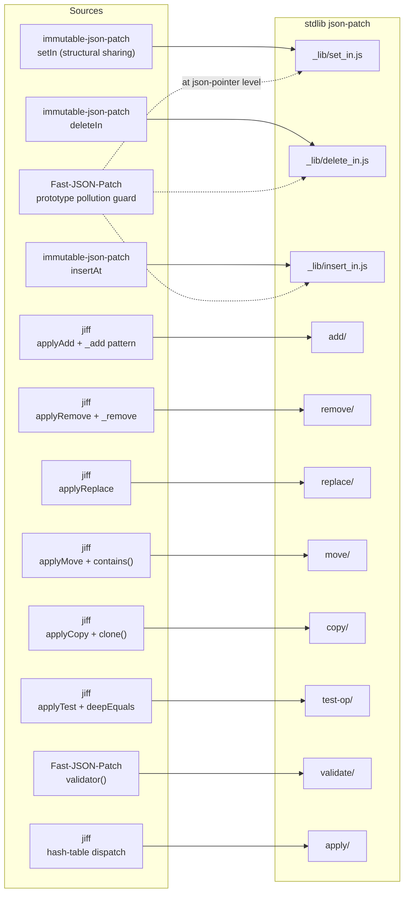

# JSON Patch Libraries — Deep Source Analysis

> A snippet-by-snippet, file-by-file breakdown of the four shortlisted libraries cloned in [`repo/`](file:///Users/gururajgurram/Projects/GSOC/stdlib/docs/json-patch/repo), explaining exactly how each mechanism works in source and what we take from each for stdlib.

---

## Table of Contents

0. [stdlib's JSON Pointer Foundation (Already Implemented)](#0-stdlibs-json-pointer-foundation-already-implemented)
1. [Library Overview & Architecture Map](#1-library-overview--architecture-map)
2. [jiff — The Functional Blueprint](#2-jiff--the-functional-blueprint)
   - 2.1 [JSON Pointer Resolution (Parent + Key Pattern)](#21-json-pointer-resolution)
   - 2.2 [JSON Pointer Parsing (Streaming Regex)](#22-json-pointer-parsing)
   - 2.3 [Operation Dispatch (Hash-Table of Handler Objects)](#23-operation-dispatch)
   - 2.4 [The Six Operations](#24-the-six-operations)
   - 2.5 [Deep Clone & Deep Equals](#25-deep-clone--deep-equals)
   - 2.6 [Patch Application Loop (clone-then-mutate)](#26-patch-application-loop)
   - 2.7 [Diff & Inverse (LCS-based)](#27-diff--inverse)
   - 2.8 [What we take from jiff](#28-what-we-take-from-jiff)
3. [Fast-JSON-Patch — The Battle-Tested Guard](#3-fast-json-patch--the-battle-tested-guard)
   - 3.1 [Dual Dispatch: objOps vs arrOps](#31-dual-dispatch-objops-vs-arrops)
   - 3.2 [Inline Pointer Walking (No Separate Module)](#32-inline-pointer-walking)
   - 3.3 [Prototype Pollution Protection](#33-prototype-pollution-protection)
   - 3.4 [Root Operations (Special-Cased)](#34-root-operations)
   - 3.5 [Batch Patch Application](#35-batch-patch-application)
   - 3.6 [Validation System](#36-validation-system)
   - 3.7 [Deep Equality with NaN Handling](#37-deep-equality-with-nan-handling)
   - 3.8 [Deep Clone Strategy (JSON round-trip)](#38-deep-clone-strategy)
   - 3.9 [Observer/Duplex (Diff by Dirty-Checking)](#39-observerduplex)
   - 3.10 [What we take from Fast-JSON-Patch](#310-what-we-take-from-fast-json-patch)
4. [immutable-json-patch — The Structural Sharing Engine](#4-immutable-json-patch--the-structural-sharing-engine)
   - 4.1 [The Immutability Helpers Core](#41-the-immutability-helpers-core)
   - 4.2 [setIn — Recursive Structural Sharing](#42-setin--recursive-structural-sharing)
   - 4.3 [deleteIn — Immutable Deletion](#43-deletein--immutable-deletion)
   - 4.4 [insertAt — Immutable Array Insert](#44-insertat--immutable-array-insert)
   - 4.5 [shallowClone & applyProp — The Building Blocks](#45-shallowclone--applyprop)
   - 4.6 [The Patch Applicator](#46-the-patch-applicator)
   - 4.7 [Revert Patch Generation](#47-revert-patch-generation)
   - 4.8 [What we take from immutable-json-patch](#48-what-we-take-from-immutable-json-patch)
5. [JSON8 Patch — The Atomic Rollback Engine](#5-json8-patch--the-atomic-rollback-engine)
   - 5.1 [Walk — The Pointer Resolver](#51-walk--the-pointer-resolver)
   - 5.2 [Operations (Return {doc, previous, idx})](#52-operations)
   - 5.3 [Apply with Atomic Rollback (try/catch + revert)](#53-apply-with-atomic-rollback)
   - 5.4 [buildRevertPatch — Inverse Operation Builder](#54-buildrevertpatch)
   - 5.5 [Validation](#55-validation)
   - 5.6 [What we take from JSON8 Patch](#56-what-we-take-from-json8-patch)
6. [Cross-Library Comparison Tables](#6-cross-library-comparison-tables)
7. [Synthesis: How Each Piece Maps to stdlib](#7-synthesis-how-each-piece-maps-to-stdlib)

---

## 0. stdlib's JSON Pointer Foundation (Already Implemented)

> Before analyzing how the four libraries handle JSON Pointers, here is what we **already have** in stdlib. The json-patch packages will build directly on top of these two packages.

Both packages live at [`@stdlib/utils/json-pointer/`](file:///Users/gururajgurram/Projects/GSOC/stdlib/lib/node_modules/@stdlib/utils/json-pointer) and are already implemented.

### 0.1 `@stdlib/utils/json-pointer/parse` — Pointer → Token Array

Source: [`parse/lib/main.js`](file:///Users/gururajgurram/Projects/GSOC/stdlib/lib/node_modules/@stdlib/utils/json-pointer/parse/lib/main.js)

```js
// @stdlib/utils/json-pointer/parse/lib/main.js — Lines 56-81
function parse( pointer ) {
    var tokens;
    var i;

    if ( !isString( pointer ) ) {
        throw new TypeError( format( 'invalid argument. Must provide a string. Value: `%s`.', pointer ) );
    }
    // An empty string refers to the root of the document:
    if ( pointer === '' ) {
        return [];
    }
    // Per RFC 6901, a non-empty pointer MUST begin with '/':
    if ( pointer.charAt( 0 ) !== '/' ) {
        throw new Error( format( 'invalid argument. JSON Pointer must be an empty string or start with a `/` character. Value: `%s`.', pointer ) );
    }

    tokens = pointer.split( '/' );
    tokens = tokens.slice( 1 );

    // Unescape reference tokens per RFC 6901
    // (note: '~1' must be replaced before '~0' to avoid corrupting sequences such as '~01'):
    for ( i = 0; i < tokens.length; i++ ) {
        tokens[ i ] = replace( tokens[ i ], /~1/g, '/' );
        tokens[ i ] = replace( tokens[ i ], /~0/g, '~' );
    }
    return tokens;
}
```

**How it works**:
1. **Type check**: Must be a primitive string (uses `@stdlib/assert/is-string`)
2. **Root**: `''` → `[]` (empty array = root pointer)
3. **Format check**: Non-empty must start with `/`
4. **Split**: `pointer.split('/')` then `.slice(1)` to drop the empty first element
5. **Unescape**: `~1` → `/` first, then `~0` → `~` (order matters — `~01` should become `~1`, not `/`)

**Return**: Always a `string[]` of decoded tokens. Example: `parse('/a~1b/c~0d')` → `['a/b', 'c~d']`

**Compared to the libraries**:
- **jiff** uses a streaming regex parser (`jsonPointerParse.js`) that emits segments via callback — more memory-efficient but harder to reason about
- **Fast-JSON-Patch** does `path.split('/')` inline inside the walking loop, unescaping lazily
- **immutable-json-patch** does the same `split('/').map(decode)` approach as stdlib
- **JSON8 Patch** delegates to the external `json8-pointer` package

Our stdlib `parse` is the cleanest approach — explicit, allocates a result array, and handles all RFC 6901 edge cases. The json-patch operations will call `parse()` to get tokens and then either pass them to `resolve()` (for read operations like `test`) or to the structural sharing helpers `setIn`/`deleteIn`/`insertIn` (for write operations).

### 0.2 `@stdlib/utils/json-pointer/resolve` — Token Walk + Parent/Key/Value

Source: [`resolve/lib/main.js`](file:///Users/gururajgurram/Projects/GSOC/stdlib/lib/node_modules/@stdlib/utils/json-pointer/resolve/lib/main.js)

```js
// @stdlib/utils/json-pointer/resolve/lib/main.js — Lines 69-149
function resolve( document, pointer ) {
    var current;
    var tokens;
    var token;
    var last;
    var key;
    var idx;
    var i;

    if ( !isPlainObject( document ) && !isArray( document ) ) {
        throw new TypeError( format( '...must be an object or an array...' ) );
    }
    tokens = parse( pointer );

    // An empty pointer refers to the root:
    if ( tokens.length === 0 ) {
        return {
            'target': null,
            'key': null,
            'value': document
        };
    }

    current = document;
    last = tokens.length - 1;

    // Traverse all tokens except the last to find the target:
    for ( i = 0; i < last; i++ ) {
        token = tokens[ i ];
        if ( !isSafeToken( token ) ) {
            throw new Error( format( '...unsafe token...' ) );
        }
        if ( isArray( current ) ) {
            if ( !RE_ARRAY_INDEX.test( token ) ) {
                throw new Error( format( '...Invalid array index...' ) );
            }
            idx = parseInt( token, 10 );
            if ( idx >= current.length ) {
                throw new RangeError( format( '...Array index out of bounds...' ) );
            }
            current = current[ idx ];
        } else if ( isPlainObject( current ) ) {
            if ( !hasOwnProp( current, token ) ) {
                throw new Error( format( '...nonexistent property...' ) );
            }
            current = current[ token ];
        } else {
            throw new TypeError( format( '...non-traversable value...' ) );
        }
    }

    // Handle the last token to determine the final key and value:
    token = tokens[ last ];
    if ( !isSafeToken( token ) ) {
        throw new Error( format( '...unsafe token...' ) );
    }
    if ( isArray( current ) ) {
        if ( token === '-' ) {
            key = current.length;                    // '-' → past-the-end index
        } else if ( RE_ARRAY_INDEX.test( token ) ) {
            key = parseInt( token, 10 );
            if ( key >= current.length ) {
                throw new RangeError( format( '...out of bounds...' ) );
            }
        } else {
            throw new Error( format( '...Invalid array index...' ) );
        }
    } else if ( isPlainObject( current ) ) {
        if ( !hasOwnProp( current, token ) ) {
            throw new Error( format( '...nonexistent property...' ) );
        }
        key = token;
    } else {
        throw new TypeError( format( '...non-traversable value...' ) );
    }
    return {
        'target': current,
        'key': key,
        'value': current[ key ]
    };
}
```

**Return shape**: `{ target, key, value }` — the parent container, the resolved key (string for objects, integer for arrays), and the value at that location.

**Key design decisions already made**:

| Feature | stdlib `resolve` | Notes |
|---------|-----------------|-------|
| **Root pointer** | `{ target: null, key: null, value: document }` | `null` target+key signals root (jiff uses `void 0` for key) |
| **`'-'` token** | Resolved to `current.length` (integer) | Only on the **last** segment; intermediate `-` is invalid |
| **Array index validation** | `/^(?:0\|[1-9][0-9]*)$/` | Rejects leading zeros (`01`), negative (`-1`), decimal (`1.5`) |
| **Property existence** | `hasOwnProp( current, token )` | Uses `@stdlib/assert/has-own-property` — more robust than jiff's `=== void 0` |
| **Type checking** | `isPlainObject` + `isArray` | Uses stdlib assertions — no `typeof` hacks |
| **Prototype pollution** | `isSafeToken()` on every token | Blocks `__proto__`, `constructor`, `prototype` — **already implemented** |
| **Bounds check** | `idx >= current.length` → `RangeError` | Strict bounds — no silent `undefined` |

### 0.3 `isSafeToken` — Prototype Pollution Guard (Already Done)

Source: [`resolve/lib/is_safe_token.js`](file:///Users/gururajgurram/Projects/GSOC/stdlib/lib/node_modules/@stdlib/utils/json-pointer/resolve/lib/is_safe_token.js)

```js
// @stdlib/utils/json-pointer/resolve/lib/is_safe_token.js — Lines 38-43
function isSafeToken( token ) {
    if ( token === '__proto__' || token === 'constructor' || token === 'prototype' ) {
        return false;
    }
    return true;
}
```

**This is stricter than Fast-JSON-Patch**: Fast-JSON-Patch only blocks `__proto__` and the specific consecutive pair `constructor/prototype`. stdlib's `isSafeToken` blocks **all three individually** — `__proto__`, `constructor`, and `prototype` are each rejected regardless of position or neighbors. This means paths like `/constructor` alone are also rejected, which is more conservative.

**Coverage comparison**:

| Path | Fast-JSON-Patch | stdlib `isSafeToken` |
|------|----------------|---------------------|
| `/__proto__/isAdmin` | ✅ Blocked | ✅ Blocked |
| `/constructor/prototype/isAdmin` | ✅ Blocked (consecutive pair) | ✅ Blocked (`constructor` alone fails) |
| `/constructor` | ❌ Allowed | ✅ Blocked |
| `/prototype` | ❌ Allowed | ✅ Blocked |
| `/foo/__proto__/bar` | ✅ Blocked | ✅ Blocked |

> [!IMPORTANT]
> **The prototype pollution guard is already built into `resolve` and runs on every single token during pointer walking**. The json-patch operations that call `resolve()` inherit this protection automatically. No additional security checks are needed at the patch operation level for pointer resolution.

### 0.4 How json-patch Operations Will Use parse & resolve

The json-patch operations use these two packages in different ways depending on whether they need to **read** or **write**:

| Operation | Needs | Uses | Why |
|-----------|-------|------|-----|
| `test` | Read value at path | `resolve(doc, path)` → `result.value` | Pure read — just compare the value |
| `replace` | Verify existence + write | `resolve(doc, path)` for existence check, then `parse(path)` tokens → `setIn()` | Must confirm path exists before immutable write |
| `remove` | Verify existence + delete | `resolve(doc, path)` for existence check, then `parse(path)` tokens → `deleteIn()` | Must confirm path exists before immutable delete |
| `add` | Write (may or may not exist) | `parse(path)` tokens → `setIn()` or `insertIn()` | `add` doesn't require prior existence, so partial resolve or direct token walk |
| `copy` | Read source + write dest | `resolve(doc, from)` → value, then `parse(path)` → `setIn()`/`insertIn()` | Read source via resolve, write via structural sharing |
| `move` | Read source + delete + write | `resolve(doc, from)` → value, `remove()` then `add()` | Composed from remove + add |

The key insight: **`resolve` is for reading and validation; `parse` + structural sharing helpers are for immutable writes**. The `setIn`/`deleteIn`/`insertIn` helpers need the raw token array (from `parse`) because they walk the document themselves while creating shallow clones at each level — they can't reuse `resolve`'s walk since they need to clone as they go.

---

## 1. Library Overview & Architecture Map

| Library | Style | Mutability | Atomicity | Prototype Protection | Entry Points |
|---------|-------|-----------|-----------|---------------------|-------------|
| **jiff** | Plain JS, CommonJS, functional | Clone-then-mutate | Pre-clone (full) | ❌ None | `jiff.js` → `lib/jsonPatch.js` → `lib/patches.js` |
| **Fast-JSON-Patch** | TypeScript, class-based errors | In-place mutate | None (partial apply) | ✅ `__proto__` + `constructor.prototype` | `src/core.ts` + `src/helpers.ts` + `src/duplex.ts` |
| **immutable-json-patch** | TypeScript, pure functional | Structural sharing (immutable) | Free (never mutates) | ❌ None | `src/immutableJSONPatch.ts` + `src/immutabilityHelpers.ts` |
| **JSON8 Patch** | Plain JS, CommonJS, modular | In-place mutate | ✅ True rollback (catch + revert) | ❌ None | `index.js` → `lib/apply.js` + individual ops |

```mermaid
graph TD
    subgraph "jiff"
        J1["jiff.js<br/>Entry point (diff+patch)"]
        J2["lib/jsonPatch.js<br/>patch() & patchInPlace()"]
        J3["lib/patches.js<br/>6 operation handlers"]
        J4["lib/jsonPointer.js<br/>find() → {target, key}"]
        J5["lib/jsonPointerParse.js<br/>Streaming regex parser"]
        J6["lib/clone.js<br/>Deep clone"]
        J7["lib/deepEquals.js<br/>Deep equality"]
        J1 --> J2
        J2 --> J3
        J3 --> J4
        J4 --> J5
        J3 --> J6
        J3 --> J7
    end

    subgraph "Fast-JSON-Patch"
        F1["src/core.ts<br/>applyOperation + applyPatch"]
        F2["src/helpers.ts<br/>deepClone, escaping, PatchError"]
        F3["src/duplex.ts<br/>observe/generate/compare"]
        F1 --> F2
        F3 --> F1
    end

    subgraph "immutable-json-patch"
        I1["src/immutableJSONPatch.ts<br/>Main applicator"]
        I2["src/immutabilityHelpers.ts<br/>setIn, deleteIn, insertAt"]
        I3["src/jsonPointer.ts<br/>parse/compile"]
        I4["src/revertJSONPatch.ts<br/>Revert generation"]
        I1 --> I2
        I1 --> I3
        I4 --> I1
    end

    subgraph "JSON8 Patch"
        P1["lib/apply.js<br/>Atomic apply with rollback"]
        P2["lib/walk.js<br/>Pointer resolver"]
        P3["lib/add.js, remove.js, etc.<br/>Individual ops"]
        P4["lib/buildRevertPatch.js<br/>Inverse builder"]
        P1 --> P3
        P3 --> P2
        P1 --> P4
    end
```



---

## 2. jiff — The Functional Blueprint

### 2.1 JSON Pointer Resolution

> **What we take**: The `find()` function's return signature `{ target: parent, key: lastSegment }` — this is the cleanest pointer resolution pattern across all libraries.

The core insight is in [jsonPointer.js](file:///Users/gururajgurram/Projects/GSOC/stdlib/docs/json-patch/repo/jiff/lib/jsonPointer.js). The `find` function walks through the document but returns the **parent** and the **last key**, not the final value itself:

```js
// jiff/lib/jsonPointer.js — Lines 42-82
function find(x, path, findContext, context) {
    if(typeof path !== 'string') {
        return;
    }

    if(path === '') {
        // whole document — key is undefined to signal "root"
        return { target: x, key: void 0 };
    }

    if(path === separator) {
        // path "/" means the empty-string key
        return { target: x, key: '' };
    }

    var parent = x, key;

    _parse(path, function(segment) {
        if(x == null) {
            parent = null;
            return false;  // early exit
        }

        if(Array.isArray(x)) {
            key = segment === '-' ? segment : parseArrayIndex(segment);
        } else {
            key = segment;
        }

        parent = x;    // save current as parent
        x = x[key];    // descend
    });

    return parent === null
        ? void 0
        : { target: parent, key: key };
}
```

**Why this pattern matters**: By returning the parent + key, every operation can work with just one line of assignment. For example, `add` on an object is just `parent[key] = value`, and `remove` on an object is just `delete parent[key]`. The operation code never needs to re-walk the path.

**The `key === void 0` convention**: When `path === ''` (root), `find` returns `{ target: x, key: void 0 }`. Operations check for `pointer.key === void 0` to know they're operating on the entire document. This is the signal to replace/return the whole document.

**The `'-'` token**: For arrays, if the segment is `'-'`, it's kept as-is (a string, not parsed as a number). The operation code specifically checks `pointer.key === '-'` to know it should append.

**How stdlib's `resolve` already implements this**: Our [`@stdlib/utils/json-pointer/resolve`](file:///Users/gururajgurram/Projects/GSOC/stdlib/lib/node_modules/@stdlib/utils/json-pointer/resolve/lib/main.js) follows the same parent+key pattern, returning `{ target, key, value }`. The differences from jiff:
- Root is `{ target: null, key: null, value: doc }` (uses `null` instead of `void 0`)
- `'-'` is eagerly resolved to `current.length` (integer) instead of kept as string
- `key` is already an integer for array targets (parsed via `parseInt`), not a string
- Every token goes through `isSafeToken()` — prototype pollution protection jiff lacks
- Uses `hasOwnProp()` for existence checks instead of jiff's fragile `=== void 0`

For the structural sharing helpers (`setIn`, `deleteIn`), we need the raw token array from [`parse()`](file:///Users/gururajgurram/Projects/GSOC/stdlib/lib/node_modules/@stdlib/utils/json-pointer/parse/lib/main.js), not the `resolve` result, since those helpers walk and clone simultaneously.

---

### 2.2 JSON Pointer Parsing

> **What we take**: The streaming architecture concept — parse without allocating an intermediate array.

[jsonPointerParse.js](file:///Users/gururajgurram/Projects/GSOC/stdlib/docs/json-patch/repo/jiff/lib/jsonPointerParse.js) uses a single regex `parseRx = /\/|~1|~0/g` to scan through the pointer string, accumulating decoded segments:

```js
// jiff/lib/jsonPointerParse.js — Lines 20-45
function jsonPointerParse(path, onSegment) {
    var pos, accum, matches, match;

    pos = path.charAt(0) === separator ? 1 : 0;  // skip leading '/'
    accum = '';
    parseRx.lastIndex = pos;

    while(matches = parseRx.exec(path)) {
        match = matches[0];
        accum += path.slice(pos, parseRx.lastIndex - match.length);
        pos = parseRx.lastIndex;

        if(match === separator) {
            // hit a '/', emit the accumulated segment
            if (onSegment(accum) === false) return path;
            accum = '';
        } else {
            // ~1 → '/', ~0 → '~'
            accum += match === encodedSeparator ? separator : escapeChar;
        }
    }

    accum += path.slice(pos);  // final segment after last '/'
    onSegment(accum);

    return path;
}
```

**Key mechanism**: Instead of `path.split('/').map(decode)` (which allocates an array + N strings), this streams segments to a callback. The callback-based API allows jiff's `find()` to walk the document node by node as segments arrive, without buffering.

**How stdlib's `parse` works instead**: Our [`@stdlib/utils/json-pointer/parse`](file:///Users/gururajgurram/Projects/GSOC/stdlib/lib/node_modules/@stdlib/utils/json-pointer/parse/lib/main.js) takes the explicit `split('/').slice(1)` approach — allocates an array, iterates to unescape `~1` → `/` then `~0` → `~`. This is the same strategy as immutable-json-patch's `parseJSONPointer()`. We prefer explicit data over callbacks because stdlib values readability and debuggability over micro-optimizations. The token array is what gets fed into both `resolve()` (internally) and directly into the structural sharing helpers.

---

### 2.3 Operation Dispatch

> **What we take**: Hash-table dispatch pattern with pure functions.

In [patches.js](file:///Users/gururajgurram/Projects/GSOC/stdlib/docs/json-patch/repo/jiff/lib/patches.js), each operation is exported as an object with `apply`, `inverse`, and `commute` methods:

```js
// jiff/lib/patches.js — Lines 15-49
exports.test = {
    apply: applyTest,
    inverse: invertTest,
    commute: commuteTest
};

exports.add = {
    apply: applyAdd,
    inverse: invertAdd,
    commute: commuteAddOrCopy
};

exports.remove = {
    apply: applyRemove,
    inverse: invertRemove,
    commute: commuteRemove
};

// ... same for replace, move, copy
```

Then in [jsonPatch.js](file:///Users/gururajgurram/Projects/GSOC/stdlib/docs/json-patch/repo/jiff/lib/jsonPatch.js), dispatch is a simple property lookup:

```js
// jiff/lib/jsonPatch.js — Lines 44-53
for(var i=0; i<changes.length; ++i) {
    p = changes[i];
    patch = patches[p.op];  // O(1) hash lookup

    if(patch === void 0) {
        throw new InvalidPatchOperationError('invalid op ' + JSON.stringify(p));
    }

    x = patch.apply(x, p, options);  // call the handler
}
```

**Why this works well**: The `patches` object is a plain dictionary keyed by operation name. Looking up `patches['add']` is O(1). No `switch`/`case`, no `if`/`else` chain. Adding a custom operation is just adding a property.

**How stdlib uses this**: Our `apply/lib/handlers.js` will use exactly this pattern, but simpler — we don't need `inverse` or `commute`, just the apply function:

```js
// What our handlers.js will look like (from approach doc):
var handlers = {
    'add': function handleAdd( doc, op ) { return add( doc, op.path, op.value ); },
    'remove': function handleRemove( doc, op ) { return remove( doc, op.path ); },
    // ...
};
```

---

### 2.4 The Six Operations

#### 2.4.1 `add` — The Most Complex Operation

```js
// jiff/lib/patches.js — Lines 106-145
function applyAdd(x, change, options) {
    var pointer = find(x, change.path, options.findContext, change.context);

    if(notFound(pointer)) {
        throw new InvalidPatchOperationError('path does not exist ' + change.path);
    }

    if(change.value === void 0) {
        throw new InvalidPatchOperationError('missing value');
    }

    var val = clone(change.value);  // ← DEFENSIVE CLONE of incoming value

    // If pointer refers to whole document, replace whole document
    if(pointer.key === void 0) {
        return val;  // ← root replacement
    }

    _add(pointer, val);
    return x;
}

function _add(pointer, value) {
    var target = pointer.target;  // the parent container

    if(Array.isArray(target)) {
        if(pointer.key === '-') {
            target.push(value);         // append
        } else if (pointer.key > target.length) {
            throw new InvalidPatchOperationError('target of add outside of array bounds')
        } else {
            target.splice(pointer.key, 0, value);  // insert before index
        }
    } else if(isValidObject(target)) {
        target[pointer.key] = value;    // object: set property (add or overwrite)
    } else {
        throw new InvalidPatchOperationError('target of add must be an object or array');
    }
}
```

**Key observations**:
1. **Value is cloned before insertion** (`clone(change.value)`) — this prevents the caller's reference from being shared with the document
2. **Root detection** via `pointer.key === void 0` — returns the value directly as the new document
3. **Array append** via `'-'` token — uses `push()`
4. **Array insert** via `splice(index, 0, value)` — shifts elements right
5. **Bounds check**: `pointer.key > target.length` (allows `=== length` for appending, but not beyond)
6. **Objects**: Simple property assignment, which both adds new keys and overwrites existing ones

**What we take**: The `_add` internal helper that cleanly separates array vs object behavior. In our immutable version, this logic maps to: arrays → `insertIn`, objects → `setIn`.

---

#### 2.4.2 `remove`

```js
// jiff/lib/patches.js — Lines 238-266
function applyRemove(x, change, options) {
    var pointer = find(x, change.path, options.findContext, change.context);

    // key must exist for remove
    if(notFound(pointer) || pointer.target[pointer.key] === void 0) {
        throw new InvalidPatchOperationError('path does not exist ' + change.path);
    }

    _remove(pointer);
    return x;
}

function _remove(pointer) {
    var target = pointer.target;
    var removed;

    if(Array.isArray(target)) {
        removed = target.splice(parseArrayIndex(pointer.key), 1);
        return removed[0];
    } else if(isValidObject(target)) {
        removed = target[pointer.key];
        delete target[pointer.key];
        return removed;
    } else {
        throw new InvalidPatchOperationError('target of remove must be an object or array');
    }
}
```

**Key observations**:
1. **Existence check**: `pointer.target[pointer.key] === void 0` — the target must exist
2. **Returns the removed value** — this is crucial for `move`, which calls `_remove` and passes the result to `_add`
3. **Array**: `splice(index, 1)` — removes and shifts elements left
4. **Object**: `delete target[key]`

**⚠️ Bug note**: The existence check `=== void 0` will fail to detect properties that are explicitly set to `undefined`. Our stdlib version should use `hasOwnProperty` instead.

---

#### 2.4.3 `replace`

```js
// jiff/lib/patches.js — Lines 173-200
function applyReplace(x, change, options) {
    var pointer = find(x, change.path, options.findContext, change.context);

    if(notFound(pointer) || missingValue(pointer)) {
        throw new InvalidPatchOperationError('path does not exist ' + change.path);
    }

    if(change.value === void 0) {
        throw new InvalidPatchOperationError('missing value');
    }

    var value = clone(change.value);  // ← defensive clone

    if(pointer.key === void 0) {
        return value;  // ← root replacement
    }

    var target = pointer.target;
    if(Array.isArray(target)) {
        target[parseArrayIndex(pointer.key)] = value;  // direct index assignment
    } else {
        target[pointer.key] = value;
    }

    return x;
}
```

**Key difference from `add`**: Replace uses direct index assignment for arrays (`target[index] = value`) instead of `splice()`. This means it overwrites in-place rather than shifting elements. The target **must already exist** (validated by `missingValue(pointer)`).

---

#### 2.4.4 `move` — With Ancestor Validation

```js
// jiff/lib/patches.js — Lines 299-309
function applyMove(x, change, options) {
    if(jsonPointer.contains(change.path, change.from)) {
        throw new InvalidPatchOperationError('move.from cannot be ancestor of move.path');
    }

    var pto = find(x, change.path, options.findContext, change.context);
    var pfrom = find(x, change.from, options.findContext, change.fromContext);

    _add(pto, _remove(pfrom));  // ← remove from source, add to destination
    return x;
}
```

**The ancestor check** uses [`contains`](file:///Users/gururajgurram/Projects/GSOC/stdlib/docs/json-patch/repo/jiff/lib/jsonPointer.js#L98-L100):

```js
// jiff/lib/jsonPointer.js — Lines 98-100
function contains(a, b) {
    return b.indexOf(a) === 0 && b[a.length] === separator;
}
```

This checks if `path` starts with `from + '/'`. Example: moving `/a/b` to `/a/b/c/d` would mean `contains('/a/b/c/d', '/a/b')` → checks if `/a/b/c/d` starts with `/a/b/`. This prevents moving a node into its own subtree.

**How the composition works**: `_remove(pfrom)` returns the removed value, which is directly passed to `_add(pto, value)`. This is a clean functional composition — remove → add.

---

#### 2.4.5 `copy`

```js
// jiff/lib/patches.js — Lines 331-349
function applyCopy(x, change, options) {
    var pto = find(x, change.path, options.findContext, change.context);
    var pfrom = find(x, change.from, options.findContext, change.fromContext);

    if(notFound(pfrom) || missingValue(pfrom)) {
        throw new InvalidPatchOperationError('copy.from must exist');
    }

    var target = pfrom.target;
    var value;
    if(Array.isArray(target)) {
        value = target[parseArrayIndex(pfrom.key)];
    } else {
        value = target[pfrom.key];
    }

    _add(pto, clone(value));  // ← DEEP CLONE is mandatory per RFC
    return x;
}
```

**Critical**: The `clone(value)` call is **required by RFC 6902** — the copy must produce an independent value. Without it, modifying the copy would also modify the original.

---

#### 2.4.6 `test`

```js
// jiff/lib/patches.js — Lines 58-76
function applyTest(x, test, options) {
    var pointer = find(x, test.path, options.findContext, test.context);
    var target = pointer.target;
    var index, value;

    if(Array.isArray(target)) {
        index = parseArrayIndex(pointer.key);
        value = target[index];
    } else {
        value = pointer.key === void 0 ? pointer.target : pointer.target[pointer.key];
    }

    if(!deepEquals(value, test.value)) {
        throw new TestFailedError('test failed ' + JSON.stringify(test));
    }

    return x;  // ← document unchanged, just validated
}
```

**Note**: `test` returns the document unchanged. It's a pure read operation that throws on failure.

---

### 2.5 Deep Clone & Deep Equals

#### Clone ([clone.js](file:///Users/gururajgurram/Projects/GSOC/stdlib/docs/json-patch/repo/jiff/lib/clone.js))

```js
// jiff/lib/clone.js — Lines 12-26
function clone(x) {
    if(x == null || typeof x !== 'object') {
        return x;  // primitives returned as-is
    }
    if (x instanceof String || x instanceof Number || x instanceof Boolean) {
        return x.valueOf();  // unwrap boxed primitives
    }
    if(Array.isArray(x)) {
        return cloneArray(x);
    }
    return cloneObject(x);
}
```

**Recursive clone**: Walks every property/element and recursively clones. Uses `Object.keys()` for objects (only own enumerable properties). Creates fresh `{}` or `new Array(l)` containers.

**How stdlib differs**: We'll use `@stdlib/utils/copy` for deep cloning, which handles more edge cases (typed arrays, Buffers, etc.).

#### DeepEquals ([deepEquals.js](file:///Users/gururajgurram/Projects/GSOC/stdlib/docs/json-patch/repo/jiff/lib/deepEquals.js))

```js
// jiff/lib/deepEquals.js — Lines 9-22
function deepEquals(a, b) {
    if(a === b) {
        return true;
    }
    if(Array.isArray(a) && Array.isArray(b)) {
        return compareArrays(a, b);
    }
    if(typeof a === 'object' && typeof b === 'object') {
        return compareObjects(a, b);
    }
    return false;
}
```

**⚠️ Bug**: `NaN === NaN` returns `false` in JavaScript, and jiff doesn't handle this case. The function falls through to `return false`. Fast-JSON-Patch handles this correctly (see §3.7).

---

### 2.6 Patch Application Loop

```js
// jiff/lib/jsonPatch.js — Lines 29-31
function patch(changes, x, options) {
    return patchInPlace(changes, clone(x), options);  // ← clone ENTIRE document first
}
```

**The "clone-then-mutate" strategy**: `patch()` deep-clones the entire document upfront, then applies all operations in-place to the clone. This is O(n) where n is document size — expensive for large Vega specs.

**`patchInPlace()`** skips the clone and mutates directly. This is what you'd use if you already have a disposable copy.

**How stdlib differs**: We use structural sharing instead (from immutable-json-patch), which is O(d × k) where d = path depth and k = operations count. Much better for large documents with small patches.

---

### 2.7 Diff & Inverse

jiff's `diff` ([jiff.js](file:///Users/gururajgurram/Projects/GSOC/stdlib/docs/json-patch/repo/jiff/jiff.js)) uses an **LCS (Longest Common Subsequence) algorithm** for arrays — this is notably more sophisticated than other libraries:

```js
// jiff/jiff.js — Lines 133-139
function appendArrayChanges(a1, a2, path, state) {
    var a1hash = array.map(state.hash, a1);
    var a2hash = array.map(state.hash, a2);
    var lcsMatrix = lcs.compare(a1hash, a2hash);
    return lcsToJsonPatch(a1, a2, path, state, lcsMatrix);
}
```

**The `inverse()` module** ([inverse.js](file:///Users/gururajgurram/Projects/GSOC/stdlib/docs/json-patch/repo/jiff/lib/inverse.js)) walks a patch backwards, calling each operation's `inverse` function:

```js
// jiff/lib/inverse.js — Lines 3-11
module.exports = function inverse(p) {
    var pr = [];
    var i, skip;
    for(i = p.length-1; i>= 0; i -= skip) {
        skip = invertOp(pr, p[i], i, p);
    }
    return pr;
};
```

**Note**: jiff's inverse requires `test` operations to precede `replace` and `remove` operations. Without those test ops, it throws `PatchNotInvertibleError`. This is why jiff's diff always generates `test` + `replace` pairs when `invertible: true`.

> **For stdlib**: Diff and inverse are Phase 2 concerns. We start with apply-only.

---

### 2.8 What We Take from jiff

| Concept | jiff Source | stdlib Usage |
|---------|-----------|-------------|
| **Parent + key pointer resolution** | `find()` returns `{ target, key }` | Already implemented in [`resolve()`](file:///Users/gururajgurram/Projects/GSOC/stdlib/lib/node_modules/@stdlib/utils/json-pointer/resolve/lib/main.js) returning `{ target, key, value }` |
| **Hash-table dispatch** | `patches[p.op].apply(...)` | `handlers.js` in `json-patch/apply` |
| **Pure functional handlers** | No `this` binding, no classes | All operation packages are pure functions |
| **Value cloning on add/replace** | `clone(change.value)` | Use `@stdlib/utils/copy` |
| **Ancestor check for move** | `jsonPointer.contains()` | Mandatory in `json-patch/move` |
| **`'-'` token handling** | `if(pointer.key === '-') target.push(value)` | `resolve()` already converts `-` → `current.length`; also handled in `insertIn` / `add` |
| **Root detection** | `pointer.key === void 0` | `resolve()` returns `{ target: null, key: null }` for root; `parse()` returns `[]` |

---

## 3. Fast-JSON-Patch — The Battle-Tested Guard

### 3.1 Dual Dispatch: objOps vs arrOps

> **What we take**: The idea of separating object and array operation handlers.

Fast-JSON-Patch maintains two separate dispatch tables in [core.ts](file:///Users/gururajgurram/Projects/GSOC/stdlib/docs/json-patch/repo/JSON-Patch/src/core.ts):

```ts
// Fast-JSON-Patch/src/core.ts — Lines 74-150

/* The operations applicable to an object */
const objOps = {
  add: function (obj, key, document) {
    obj[key] = this.value;               // simple property set
    return { newDocument: document };
  },
  remove: function (obj, key, document) {
    var removed = obj[key];
    delete obj[key];                      // delete property
    return { newDocument: document, removed }
  },
  replace: function (obj, key, document) {
    var removed = obj[key];
    obj[key] = this.value;                // overwrite property
    return { newDocument: document, removed };
  },
  // move and copy delegate back to applyOperation (recursive)
  move: function (obj, key, document) {
    let removed = getValueByPointer(document, this.path);
    if (removed) { removed = _deepClone(removed); }

    const originalValue = applyOperation(document,
      { op: "remove", path: this.from }
    ).removed;

    applyOperation(document,
      { op: "add", path: this.path, value: originalValue }
    );

    return { newDocument: document, removed };
  },
  copy: function (obj, key, document) {
    const valueToCopy = getValueByPointer(document, this.from);
    applyOperation(document,
      { op: "add", path: this.path, value: _deepClone(valueToCopy) }
    );
    return { newDocument: document }
  },
  test: function (obj, key, document) {
    return { newDocument: document, test: _areEquals(obj[key], this.value) }
  },
};

/* The operations applicable to an array */
var arrOps = {
  add: function (arr, i, document) {
    if(isInteger(i)) {
      arr.splice(i, 0, this.value);       // insert at index
    } else {
      arr[i] = this.value;                // array props (rare)
    }
    return { newDocument: document, index: i }
  },
  remove: function (arr, i, document) {
    var removedList = arr.splice(i, 1);    // splice out element
    return { newDocument: document, removed: removedList[0] };
  },
  replace: function (arr, i, document) {
    var removed = arr[i];
    arr[i] = this.value;                   // direct index assignment
    return { newDocument: document, removed };
  },
  move: objOps.move,     // ← reuses object's move
  copy: objOps.copy,     // ← reuses object's copy
  test: objOps.test,     // ← reuses object's test
  _get: objOps._get
};
```

**Key observations**:
1. **`this.value`**: Operations are called with `.call(operation, ...)`, so `this` is the operation object. This is an unusual pattern.
2. **`move` and `copy` self-recurse** by calling `applyOperation()` — they compose `remove` + `add` internally
3. **Array `add`** uses `splice(i, 0, value)` for integer indices, but also supports string-keyed properties on arrays via `arr[i] = this.value`
4. **Array `move`, `copy`, `test`** are shared with object ops — they work at the document level

**How stdlib differs**: We don't split into objOps/arrOps. Instead, each operation package handles both cases internally (like jiff). And we never use `this` binding — pure function arguments only.

---

### 3.2 Inline Pointer Walking

Fast-JSON-Patch doesn't have a separate pointer module. The walking happens inline in `applyOperation`:

```ts
// Fast-JSON-Patch/src/core.ts — Lines 230-314
else {
    if (!mutateDocument) {
        document = _deepClone(document);    // full clone if requested
    }
    const path = operation.path || "";
    const keys = path.split('/');
    let obj = document;
    let t = 1;                              // skip empty first element
    let len = keys.length;

    while (true) {
        key = keys[t];
        if (key && key.indexOf('~') != -1) {
            key = unescapePathComponent(key);    // ~0 → ~, ~1 → /
        }

        // ← PROTOTYPE POLLUTION CHECK (see §3.3)
        if(banPrototypeModifications &&
            (key == '__proto__' ||
            (key == 'prototype' && t>0 && keys[t-1] == 'constructor'))
        ) {
            throw new TypeError('...');
        }

        t++;
        if (Array.isArray(obj)) {
            if (key === '-') {
                key = obj.length;               // '-' → append index
            } else if(isInteger(key)) {
                key = ~~key;                     // string → integer
            }
            if (t >= len) {
                // ← We're at the final segment, apply the operation
                const returnValue = arrOps[operation.op].call(operation, obj, key, document);
                if (returnValue.test === false) {
                    throw new JsonPatchError("Test operation failed", ...);
                }
                return returnValue;
            }
        } else {
            if (t >= len) {
                const returnValue = objOps[operation.op].call(operation, obj, key, document);
                // ...
                return returnValue;
            }
        }
        obj = obj[key];  // descend one level
    }
}
```

**How the walk works**:
1. Split path on `/`, skip index 0 (empty string before first `/`)
2. Walk token by token, descending into the document
3. At the second-to-last iteration (`t >= len`), we've found the parent — dispatch to the appropriate ops table
4. The **tilde unescaping** is done lazily (only when `~` is detected in the segment)

**How stdlib differs**: We have dedicated [`json-pointer/parse`](file:///Users/gururajgurram/Projects/GSOC/stdlib/lib/node_modules/@stdlib/utils/json-pointer/parse/lib/main.js) and [`json-pointer/resolve`](file:///Users/gururajgurram/Projects/GSOC/stdlib/lib/node_modules/@stdlib/utils/json-pointer/resolve/lib/main.js) as separate packages. Our `resolve` walks with the same loop-until-last-token approach but uses `isPlainObject()` + `isArray()` stdlib assertions, `hasOwnProp()` for existence, and `isSafeToken()` for prototype pollution — none of which Fast-JSON-Patch's inline walker does cleanly.

---

### 3.3 Prototype Pollution Protection

> **What Fast-JSON-Patch does**: This was the #1 security insight from reviewing Fast-JSON-Patch. **We have already implemented an even stricter version** in our [`isSafeToken()`](file:///Users/gururajgurram/Projects/GSOC/stdlib/lib/node_modules/@stdlib/utils/json-pointer/resolve/lib/is_safe_token.js).

**Fast-JSON-Patch's approach** (for reference):

```ts
// Fast-JSON-Patch/src/core.ts — Lines 254-259
if(banPrototypeModifications &&
    (key == '__proto__' ||
    (key == 'prototype' && t>0 && keys[t-1] == 'constructor'))
) {
    throw new TypeError('JSON-Patch: modifying `__proto__` or ' +
      '`constructor/prototype` prop is banned for security reasons...');
}
```

**What this prevents**: An attacker could craft a patch like:
```json
[{"op": "add", "path": "/__proto__/isAdmin", "value": true}]
```

This would set `Object.prototype.isAdmin = true`, making **every** object in the runtime appear to be an admin.

**stdlib's stricter implementation** (already done in [`resolve/lib/is_safe_token.js`](file:///Users/gururajgurram/Projects/GSOC/stdlib/lib/node_modules/@stdlib/utils/json-pointer/resolve/lib/is_safe_token.js)):

```js
// @stdlib/utils/json-pointer/resolve/lib/is_safe_token.js — Lines 38-43
function isSafeToken( token ) {
    if ( token === '__proto__' || token === 'constructor' || token === 'prototype' ) {
        return false;
    }
    return true;
}
```

And it's called on **every token** during the resolve walk (both intermediate and final):

```js
// @stdlib/utils/json-pointer/resolve/lib/main.js — Lines 96-100 & 121-123
for ( i = 0; i < last; i++ ) {
    token = tokens[ i ];
    if ( !isSafeToken( token ) ) {
        throw new Error( format( '...unsafe token...' ) );
    }
    // ... walk ...
}
// ... and for the last token:
token = tokens[ last ];
if ( !isSafeToken( token ) ) {
    throw new Error( format( '...unsafe token...' ) );
}
```

**Why stdlib's version is stricter**:

| Path | Fast-JSON-Patch | stdlib `isSafeToken` |
|------|----------------|---------------------|
| `/__proto__/isAdmin` | ✅ Blocked | ✅ Blocked |
| `/constructor/prototype/x` | ✅ Blocked (pair check) | ✅ Blocked (`constructor` alone fails) |
| `/constructor` | ❌ **Allowed** | ✅ Blocked |
| `/prototype` | ❌ **Allowed** | ✅ Blocked |
| `/foo/prototype/bar` | ❌ **Allowed** (no `constructor` before it) | ✅ Blocked |

Fast-JSON-Patch has a `banPrototypeModifications` flag that can be turned off. **stdlib has no opt-out** — this is a security invariant baked into the resolver itself.

> [!IMPORTANT]
> **This is already done.** Because `resolve()` calls `isSafeToken()` on every token, all json-patch operations that use `resolve()` automatically inherit prototype pollution protection. The structural sharing helpers (`setIn`, `deleteIn`, `insertIn`) also need to include this check since they walk tokens independently of `resolve`.

---

### 3.4 Root Operations

Fast-JSON-Patch special-cases root operations (`path === ""`) before the walking loop:

```ts
// Fast-JSON-Patch/src/core.ts — Lines 192-229
if (operation.path === "") {
    let returnValue: OperationResult<T> = { newDocument: document };

    if (operation.op === 'add') {
        returnValue.newDocument = operation.value;
        return returnValue;
    } else if (operation.op === 'replace') {
        returnValue.newDocument = operation.value;
        returnValue.removed = document;
        return returnValue;
    }
    else if (operation.op === 'move' || operation.op === 'copy') {
        returnValue.newDocument = getValueByPointer(document, operation.from);
        if (operation.op === 'move') {
            returnValue.removed = document;
        }
        return returnValue;
    } else if (operation.op === 'test') {
        returnValue.test = _areEquals(document, operation.value);
        if (returnValue.test === false) {
            throw new JsonPatchError("Test operation failed", ...);
        }
        returnValue.newDocument = document;
        return returnValue;
    } else if (operation.op === 'remove') {
        returnValue.removed = document;
        returnValue.newDocument = null;  // ← removes root → null
        return returnValue;
    }
}
```

**Interesting**: Fast-JSON-Patch allows `remove` on root (sets document to `null`). RFC 6902 says this is an error. We follow the RFC and reject it.

---

### 3.5 Batch Patch Application

```ts
// Fast-JSON-Patch/src/core.ts — Lines 331-349
export function applyPatch<T>(document: T, patch: ReadonlyArray<Operation>,
  validateOperation?, mutateDocument = true, banPrototypeModifications = true
): PatchResult<T> {
    if(validateOperation) {
        if(!Array.isArray(patch)) {
            throw new JsonPatchError('Patch sequence must be an array', ...);
        }
    }
    if (!mutateDocument) {
        document = _deepClone(document);  // ← full clone if immutable mode requested
    }
    const results = new Array(patch.length) as PatchResult<T>;

    for (let i = 0, length = patch.length; i < length; i++) {
        results[i] = applyOperation(document, patch[i], validateOperation, true, ...);
        document = results[i].newDocument;  // ← track root changes
    }
    results.newDocument = document;
    return results;
}
```

**Key observations**:
1. **No atomicity** — if operation 3 out of 5 fails, operations 0-2 have already mutated the document. No rollback.
2. **`mutateDocument: false`** does a full `_deepClone` upfront — same O(n) strategy as jiff
3. **Results array** tracks each operation's result — useful for debugging but overhead we don't need
4. **Root replacement tracking**: `document = results[i].newDocument` handles cases where `add` at root replaces the entire document reference

---

### 3.6 Validation System

```ts
// Fast-JSON-Patch/src/core.ts — Lines 375-426
export function validator(operation, index, document?, existingPathFragment?) {
    if (typeof operation !== 'object' || operation === null || Array.isArray(operation)) {
        throw new JsonPatchError('Operation is not an object', 'OPERATION_NOT_AN_OBJECT', ...);
    }
    else if (!objOps[operation.op]) {
        throw new JsonPatchError('Operation `op` property is not one of operations defined in RFC-6902',
          'OPERATION_OP_INVALID', ...);
    }
    else if (typeof operation.path !== 'string') {
        throw new JsonPatchError('Operation `path` property is not a string', 'OPERATION_PATH_INVALID', ...);
    }
    else if (operation.path.indexOf('/') !== 0 && operation.path.length > 0) {
        throw new JsonPatchError('Operation `path` property must start with "/"', ...);
    }
    else if ((operation.op === 'move' || operation.op === 'copy') && typeof operation.from !== 'string') {
        throw new JsonPatchError('Operation `from` property is not present', 'OPERATION_FROM_REQUIRED', ...);
    }
    else if ((operation.op === 'add' || operation.op === 'replace' || operation.op === 'test')
              && operation.value === undefined) {
        throw new JsonPatchError('Operation `value` property is not present', 'OPERATION_VALUE_REQUIRED', ...);
    }
    else if (...hasUndefined(operation.value)) {
        throw new JsonPatchError('...', 'OPERATION_VALUE_CANNOT_CONTAIN_UNDEFINED', ...);
    }
    // ... document-level validation follows
}
```

**Validation checks (in order)**:
1. Is the operation a non-null, non-array object?
2. Is `op` one of the six valid operations?
3. Is `path` a string?
4. Does `path` start with `/` (unless empty)?
5. Do `move`/`copy` have a string `from`?
6. Do `add`/`replace`/`test` have a `value`?
7. Does `value` contain any `undefined` (recursively)?

**The error typing** uses a `JsonPatchErrorName` enum with codes like `OPERATION_NOT_AN_OBJECT`, `OPERATION_OP_INVALID`, etc. This is thorough.

**How stdlib uses this**: Our `json-patch/validate` package will do similar checks but return `Error | null` instead of throwing. This separates validation from application.

---

### 3.7 Deep Equality with NaN Handling

> **What we take**: The NaN check. This is the only library that handles it correctly.

```ts
// Fast-JSON-Patch/src/core.ts — Lines 483-521
export function _areEquals(a: any, b: any): boolean {
    if (a === b) return true;

    if (a && b && typeof a == 'object' && typeof b == 'object') {
        var arrA = Array.isArray(a), arrB = Array.isArray(b), i, length, key;

        if (arrA && arrB) {
            length = a.length;
            if (length != b.length) return false;
            for (i = length; i-- !== 0;)
                if (!_areEquals(a[i], b[i])) return false;
            return true;
        }
        if (arrA != arrB) return false;

        var keys = Object.keys(a);
        length = keys.length;
        if (length !== Object.keys(b).length) return false;

        for (i = length; i-- !== 0;)
            if (!b.hasOwnProperty(keys[i])) return false;

        for (i = length; i-- !== 0;) {
            key = keys[i];
            if (!_areEquals(a[key], b[key])) return false;
        }
        return true;
    }

    return a!==a && b!==b;  // ← NaN === NaN check!
}
```

**The magic line**: `return a!==a && b!==b` — in JavaScript, `NaN` is the only value not equal to itself. So `a!==a` is `true` only when `a` is `NaN`. This makes `_areEquals(NaN, NaN)` return `true`, which is correct for JSON Patch's `test` operation.

**How stdlib uses this**: We'll use `@stdlib/assert/deep-equal` which already handles NaN correctly.

---

### 3.8 Deep Clone Strategy

```ts
// Fast-JSON-Patch/src/helpers.ts — Lines 36-45
export function _deepClone(obj) {
    switch (typeof obj) {
        case "object":
            return JSON.parse(JSON.stringify(obj));  // ← JSON round-trip!
        case "undefined":
            return null;
        default:
            return obj;
    }
}
```

**Trade-off**: `JSON.parse(JSON.stringify(obj))` is actually faster than recursive cloning for most objects (V8 optimizes it), but it has limitations:
- Loses `undefined` values (converts to `null` in arrays, omits from objects)
- Loses special numbers (`Infinity`, `NaN` → `null`)
- Loses functions, symbols, dates, regexes
- Can't handle circular references

**For JSON data specifically** (no dates, functions, etc.), this is fine and fast. But stdlib needs proper deep cloning via `@stdlib/utils/copy`.

---

### 3.9 Observer/Duplex (Diff by Dirty-Checking)

[duplex.ts](file:///Users/gururajgurram/Projects/GSOC/stdlib/docs/json-patch/repo/JSON-Patch/src/duplex.ts) implements an observer pattern for generating patches:

```ts
// Fast-JSON-Patch/src/duplex.ts — Lines 60-120 (simplified)
export function observe<T>(obj, callback?) {
    var mirror = getMirror(obj);
    if (!mirror) {
        mirror = new Mirror(obj);
        beforeDict.set(obj, mirror);     // WeakMap stores the snapshot
    }

    mirror.value = _deepClone(obj);       // ← snapshot

    if (callback) {
        // Dirty-check on mouse/key events (browser only)
        window.addEventListener('mouseup', fastCheck);
        window.addEventListener('keyup', fastCheck);
        // ...
    }

    return observer;
}

export function generate<T>(observer, invertible = false) {
    var mirror = beforeDict.get(observer.object);
    _generate(mirror.value, observer.object, observer.patches, "", invertible);
    // ...
}
```

The `_generate` function recursively compares the snapshot with the current object and produces patches. This is the `compare()` API:

```ts
// Fast-JSON-Patch/src/duplex.ts — Lines 208-212
export function compare(tree1, tree2, invertible = false): Operation[] {
    var patches = [];
    _generate(tree1, tree2, patches, '', invertible);
    return patches;
}
```

> **For stdlib**: This is the diff functionality. Not in Phase 1 scope, but the `compare()` approach (snapshot-based diff) is simpler than jiff's LCS approach for objects. We'd likely implement a similar recursive diff.

---

### 3.10 What We Take from Fast-JSON-Patch

| Concept | Fast-JSON-Patch Source | stdlib Usage |
|---------|----------------------|-------------|
| **Prototype pollution guard** | `__proto__` + `constructor/prototype` check | **Already implemented** in [`isSafeToken()`](file:///Users/gururajgurram/Projects/GSOC/stdlib/lib/node_modules/@stdlib/utils/json-pointer/resolve/lib/is_safe_token.js) inside `resolve()` — stricter (blocks all 3 individually) |
| **NaN-aware deep equality** | `a!==a && b!==b` | Via `@stdlib/assert/deep-equal` |
| **Validation error codes** | `OPERATION_NOT_AN_OBJECT`, etc. | Named error messages in `json-patch/validate` |
| **`value` presence check** | `operation.value === undefined` | In our validate package |
| **Path must start with `/`** | `operation.path.indexOf('/') !== 0` | In our validate package |
| **`hasUndefined` recursive check** | Catches nested `undefined` in values | Optional — JSON can't have `undefined` |

---

## 4. immutable-json-patch — The Structural Sharing Engine

### 4.1 The Immutability Helpers Core

This is the most important library for our stdlib implementation. The entire immutability system lives in [immutabilityHelpers.ts](file:///Users/gururajgurram/Projects/GSOC/stdlib/docs/json-patch/repo/immutable-json-patch/src/immutabilityHelpers.ts).

The key exported functions:
- `shallowClone(value)` — shallow copy of object/array/value
- `applyProp(object, key, value)` — immutably set a single property (with identity check)
- `getIn(object, path)` — read a value at a path
- `setIn(object, path, value)` — immutably set a value at a path
- `updateIn(object, path, transform)` — immutably transform a value at a path
- `deleteIn(object, path)` — immutably delete a value at a path
- `insertAt(document, path, value)` — immutably insert into an array at a path
- `existsIn(document, path)` — check if a path exists
- `transform(document, callback)` — traverse and transform

---

### 4.2 setIn — Recursive Structural Sharing

> **What we take**: This exact algorithm is what our `_lib/set_in.js` implements.

```ts
// immutable-json-patch/src/immutabilityHelpers.ts — Lines 106-132
export function setIn<T, U = unknown, V = unknown>(
  object: U,
  path: JSONPath,
  value: V,
  createPath = false
): T {
  if (path.length === 0) {
    return value as unknown as T          // ← base case: replace entire subtree
  }

  const key = path[0]
  const updatedValue = setIn(             // ← RECURSE on the child
    object ? object[key] : undefined,
    path.slice(1),                        // remaining path
    value,
    createPath
  )

  if (isJSONObject(object) || isJSONArray(object)) {
    return applyProp(object, key, updatedValue) as T   // ← shallow clone + set
  }

  if (createPath) {
    const newObject = IS_INTEGER_REGEX.test(key) ? [] : {}
    newObject[key] = updatedValue
    return newObject as T
  }

  throw new Error('Path does not exist')
}
```

**How it works, step by step** (for `setIn(doc, ['a', 'b', 'c'], 99)`):

```
Call 1: setIn(doc, ['a', 'b', 'c'], 99)
  → key = 'a'
  → recurse: setIn(doc.a, ['b', 'c'], 99)

Call 2: setIn(doc.a, ['b', 'c'], 99)
  → key = 'b'
  → recurse: setIn(doc.a.b, ['c'], 99)

Call 3: setIn(doc.a.b, ['c'], 99)
  → key = 'c'
  → recurse: setIn(doc.a.b.c, [], 99)

Call 4: setIn(doc.a.b.c, [], 99)
  → path.length === 0
  → return 99                           ← the new value

Back to Call 3:
  → updatedValue = 99
  → applyProp(doc.a.b, 'c', 99)
  → doc.a.b.c was 1, 99 !== 1
  → shallowClone(doc.a.b) → newB = {c: 99, d: 2}   ← NEW object
  → return newB

Back to Call 2:
  → updatedValue = newB
  → applyProp(doc.a, 'b', newB)
  → doc.a.b !== newB (different reference)
  → shallowClone(doc.a) → newA = {b: newB, e: 3}    ← NEW object, e shared
  → return newA

Back to Call 1:
  → updatedValue = newA
  → applyProp(doc, 'a', newA)
  → doc.a !== newA
  → shallowClone(doc) → newDoc = {a: newA, f: 4}    ← NEW object, f shared
  → return newDoc
```

**Result**: 3 new objects (newDoc, newA, newB). Everything else (`.d`, `.e`, `.f`) shares references with the original.

---

### 4.3 deleteIn — Immutable Deletion

```ts
// immutable-json-patch/src/immutabilityHelpers.ts — Lines 168-201
export function deleteIn<T, U = unknown>(object: U, path: JSONPath): T {
  if (path.length === 0) {
    return object as unknown as T         // deleting root = return as-is
  }

  if (!isObjectOrArray(object)) {
    throw new Error('Path does not exist')
  }

  if (path.length === 1) {               // ← BASE CASE: final segment
    const key = path[0]
    if (!(key in (object as object))) {
      return object as unknown as T       // key doesn't exist, return unchanged
    }
    const updatedObject = shallowClone(object)

    if (isJSONArray(updatedObject)) {
      updatedObject.splice(Number.parseInt(key, 10), 1)   // ← array: splice out
    }

    if (isJSONObject(updatedObject)) {
      delete updatedObject[key]           // ← object: delete property
    }

    return updatedObject as unknown as T
  }

  // ← RECURSIVE CASE: path.length > 1
  const key = path[0]
  const updatedValue = deleteIn(object[key], path.slice(1))
  return applyProp(object, key, updatedValue)   // ← structural sharing up the path
}
```

**Key differences from `setIn`**:
1. At the leaf, instead of setting a value, it either `splice`s (array) or `delete`s (object)
2. If the key doesn't exist, it returns the object unchanged (no error)
3. The structural sharing up the chain is identical — `applyProp` shallow-clones each ancestor

---

### 4.4 insertAt — Immutable Array Insert

```ts
// immutable-json-patch/src/immutabilityHelpers.ts — Lines 209-223
export function insertAt<T, U = unknown>(document: T, path: JSONPath, value: U): T {
  const parentPath = path.slice(0, path.length - 1)   // all but last
  const index = path[path.length - 1]                  // last token = array index

  return updateIn(document, parentPath, (items) => {
    if (!Array.isArray(items)) {
      throw new TypeError(`Array expected at path ${JSON.stringify(parentPath)}`)
    }

    const updatedItems = shallowClone(items)           // shallow clone the array
    updatedItems.splice(Number.parseInt(index, 10), 0, value)  // insert at index
    return updatedItems
  })
}
```

**How it leverages `updateIn`**: Instead of reimplementing the path-walking, `insertAt` uses `updateIn(doc, parentPath, transformFn)` which:
1. Walks to the parent (the array)
2. Applies the transform function (clone array + splice)
3. Structural-shares all the way back up

**`updateIn`** itself ([lines 142-160](file:///Users/gururajgurram/Projects/GSOC/stdlib/docs/json-patch/repo/immutable-json-patch/src/immutabilityHelpers.ts#L142-L160)):

```ts
export function updateIn<T, U = unknown, V = unknown>(
  object: T, path: JSONPath, transform: (value: U) => V
): T {
  if (path.length === 0) {
    return transform(object as unknown as U) as unknown as T
  }

  if (!isObjectOrArray(object)) {
    throw new Error("Path doesn't exist")
  }

  const key = path[0]
  const updatedValue = updateIn(object[key], path.slice(1), transform)
  return applyProp(object, key, updatedValue)
}
```

This is essentially `setIn` but instead of providing the final value directly, you provide a transform function that receives the current value and returns the new value.

---

### 4.5 shallowClone & applyProp — The Building Blocks

```ts
// immutable-json-patch/src/immutabilityHelpers.ts — Lines 19-47
export function shallowClone<T>(value: T): T {
  if (isJSONArray(value)) {
    const copy: T = value.slice() as T    // ← array: slice()

    // also copy symbols (for metadata)
    Object.getOwnPropertySymbols(value).forEach((symbol) => {
      copy[symbol] = value[symbol]
    })
    return copy
  }

  if (isJSONObject(value)) {
    const copy: T = { ...value }          // ← object: spread

    Object.getOwnPropertySymbols(value).forEach((symbol) => {
      copy[symbol] = value[symbol]
    })
    return copy
  }

  return value  // ← primitive: return as-is
}
```

**`applyProp`** is the identity-checking wrapper:

```ts
// immutable-json-patch/src/immutabilityHelpers.ts — Lines 53-64
export function applyProp<T, U = unknown>(object: T, key: string | number, value: U): T {
  if (object[key] === value) {
    return object                          // ← IDENTITY CHECK: no change → no clone
  }

  const updatedObject = shallowClone(object)
  updatedObject[key] = value
  return updatedObject
}
```

**The identity optimization**: If the value at the key is already `===` the new value, `applyProp` returns the original object. This means if nothing actually changed (e.g., `setIn(doc, ['a'], doc.a)`), the entire chain returns the original objects — zero allocations. This is important for React-style `===` change detection.

**How stdlib uses this**: Our `_lib/set_in.js` should include this identity check. It's free and prevents unnecessary allocations.

---

### 4.6 The Patch Applicator

```ts
// immutable-json-patch/src/immutableJSONPatch.ts — Lines 17-78
export function immutableJSONPatch<T, U = unknown>(
  document: U, operations: JSONPatchDocument, options?: JSONPatchOptions
): T {
  let updatedDocument = document as unknown as T

  for (let i = 0; i < operations.length; i++) {
    validateJSONPatchOperation(operations[i])

    let operation = operations[i]

    // "before" hook — allows intercepting/modifying operations
    if (options?.before) { /* ... */ }

    const previousDocument = updatedDocument
    const path = parsePath(updatedDocument, operation.path)

    if (operation.op === 'add') {
      updatedDocument = add(updatedDocument, path, operation.value)
    } else if (operation.op === 'remove') {
      updatedDocument = remove(updatedDocument, path)
    } else if (operation.op === 'replace') {
      updatedDocument = replace(updatedDocument, path, operation.value)
    } else if (operation.op === 'copy') {
      updatedDocument = copy(updatedDocument, path, parseFrom(operation.from))
    } else if (operation.op === 'move') {
      updatedDocument = move(updatedDocument, path, parseFrom(operation.from))
    } else if (operation.op === 'test') {
      test(updatedDocument, path, operation.value)
    }

    // "after" hook
    if (options?.after) { /* ... */ }
  }

  return updatedDocument
}
```

**Atomicity is free**: Because each operation returns a **new** document (the original is never mutated), if operation 3 throws, `updatedDocument` holds the result of operations 0-2 but the original `document` reference is completely untouched. The caller's reference to the original is safe.

**The individual operation functions** are elegantly simple:

```ts
// Lines 83-128
export function replace<T>(document, path, value): T {
  return existsIn(document, path) ? setIn(document, path, value) : document
}

export function remove<T>(document, path): T {
  return deleteIn(document, path)
}

export function add<T>(document, path, value): T {
  if (isArrayItem(document, path)) {
    return insertAt(document, path, value)     // array → insert
  }
  return setIn(document, path, value)          // object → set
}

export function copy<T>(document, path, from): T {
  const value = getIn(document, from)
  if (isArrayItem(document, path)) {
    return insertAt(document, path, value)
  }
  return setIn(document, path, value)
}

export function move<T>(document, path, from): T {
  const value = getIn(document, from)
  const removedJson = deleteIn(document, from)
  return isArrayItem(removedJson, path)
    ? insertAt(removedJson, path, value)
    : setIn(removedJson, path, value)
}
```

**`isArrayItem`** determines whether the destination is inside an array:

```ts
export function isArrayItem(document, path): boolean {
  if (path.length === 0) return false
  const parent = getIn(document, initial(path))   // get parent
  return Array.isArray(parent)
}
```

**⚠️ Notable gap**: `copy` does **NOT** deep clone the value. It passes `getIn(document, from)` directly to `setIn`/`insertAt`. For immutable usage this is fine (the structural sharing means modifications create new objects anyway), but for our stdlib implementation we should deep clone for RFC compliance.

**⚠️ Another gap**: `replace` silently returns the document unchanged if the path doesn't exist (`existsIn` returns false). RFC 6902 says `replace` on a non-existent path should error.

---

### 4.7 Revert Patch Generation

[revertJSONPatch.ts](file:///Users/gururajgurram/Projects/GSOC/stdlib/docs/json-patch/repo/immutable-json-patch/src/revertJSONPatch.ts) generates inverse operations by hooking into the `before` callback:

```ts
// immutable-json-patch/src/revertJSONPatch.ts — Lines 24-80
export function revertJSONPatch<T>(document, operations, options?) {
  let allRevertOperations = []

  const before = (document, operation) => {
    let revertOperations
    const path = parsePath(document, operation.path)

    if (operation.op === 'add') {
      revertOperations = revertAdd(document, path)
    } else if (operation.op === 'remove') {
      revertOperations = revertRemove(document, path)
    } else if (operation.op === 'replace') {
      revertOperations = revertReplace(document, path)
    }
    // ... copy, move

    allRevertOperations = revertOperations.concat(allRevertOperations)
    return {}
  }

  immutableJSONPatch(document, operations, { before })  // apply with hooks

  return allRevertOperations
}
```

**The inverse operations**:
```ts
function revertReplace(document, path) {
  return existsIn(document, path)
    ? [{ op: 'replace', path: compileJSONPointer(path), value: getIn(document, path) }]
    : []
}

function revertRemove(document, path) {
  return [{ op: 'add', path: compileJSONPointer(path), value: getIn(document, path) }]
}

function revertAdd(document, path) {
  if (isArrayItem(document, path) || !existsIn(document, path)) {
    return [{ op: 'remove', path: compileJSONPointer(path) }]
  }
  return revertReplace(document, path)  // add overwrites existing → revert is replace
}
```

**Key insight**: Because the `before` hook runs before each operation is applied, `getIn(document, path)` captures the **current** (pre-operation) value. This is what the revert needs — the value that was there before the operation changed it.

> **For stdlib**: This is a future concern. The revert/inverse functionality is not in Phase 1.

---

### 4.8 What We Take from immutable-json-patch

| Concept | Source | stdlib Usage |
|---------|--------|-------------|
| **`setIn` recursive structural sharing** | `immutabilityHelpers.ts:106-132` | Core of `_lib/set_in.js` |
| **`deleteIn` immutable deletion** | `immutabilityHelpers.ts:168-201` | Core of `_lib/delete_in.js` |
| **`insertAt` immutable array insert** | `immutabilityHelpers.ts:209-223` | Core of `_lib/insert_in.js` |
| **`applyProp` identity optimization** | `immutabilityHelpers.ts:53-64` | Include in our `setIn` |
| **`shallowClone`** | `immutabilityHelpers.ts:19-47` | Internal helper (without symbol copying) |
| **`isArrayItem` check** | `immutableJSONPatch.ts:149-157` | Decision logic in `add` between `setIn` / `insertAt` |
| **`resolvePathIndex` for `-`** | `immutableJSONPatch.ts:163-173` | Handle `-` → `array.length` in `add` |
| **Free atomicity** | Never mutates original | Our primary atomicity strategy |

---

## 5. JSON8 Patch — The Atomic Rollback Engine

### 5.1 Walk — The Pointer Resolver

[walk.js](file:///Users/gururajgurram/Projects/GSOC/stdlib/docs/json-patch/repo/patch/lib/walk.js) returns `[lastToken, parent]` — same concept as jiff's `find()` but as an array:

```js
// JSON8/lib/walk.js — Lines 13-39
module.exports = function walk(doc, tokens) {
  var length = tokens.length
  var i = 0
  var target = doc
  var token

  while (i < length - 1) {
    token = tokens[i++]

    if (Array.isArray(target))
      validArrayToken(token, target.length)      // validate array index
    else if (typeof target !== OBJECT || target === null)
      throw new Error('Cannot be walked')

    target = target[token]                        // descend
  }

  token = tokens[i]                               // last token

  if (Array.isArray(target))
    validArrayToken(token, target.length)
  else if (typeof target !== OBJECT || target === null)
    throw new Error('Invalid target')

  return [token, target]                          // [lastKey, parent]
}
```

**Differences from jiff**:
1. Returns `[token, target]` instead of `{ target, key }` — positional instead of named
2. Uses `json8-pointer`'s `validArrayToken` for validation during walk
3. Doesn't handle root (`tokens.length === 0`) — that's handled by each operation individually
4. Takes pre-decoded tokens (array), not a string pointer

---

### 5.2 Operations

All operations follow the same return contract: `{ doc, previous, idx }`.

#### `add` ([add.js](file:///Users/gururajgurram/Projects/GSOC/stdlib/docs/json-patch/repo/patch/lib/add.js)):

```js
// JSON8/lib/add.js — Lines 23-51
module.exports = function add(doc, path, value) {
  var tokens = decode(path)

  if (tokens.length === 0)
    return {doc: value, previous: doc}          // root replacement

  var r = walk(doc, tokens)
  var token = r[0]    // last key
  var parent = r[1]   // parent container

  var previous
  var idx

  if (Array.isArray(parent)) {
    if (token === '-') {
      parent.push(value)
      idx = parent.length - 1                   // record index for revert
    }
    else
      parent.splice(token, 0, value)
  }
  else {
    previous = parent[token]                    // record previous for revert
    parent[token] = value
  }

  return {doc: doc, previous: previous, idx: idx}
}
```

**The `previous` and `idx` fields** are critical for atomic rollback. They record what was there before the operation, so it can be undone:
- For object add that overwrites: `previous = parent[token]` captures the old value
- For array append with `-`: `idx = parent.length - 1` records the actual index used (needed because `-` doesn't translate to a fixed index)

#### `remove`:

```js
// JSON8/lib/remove.js — Lines 22-43
module.exports = function remove(doc, path) {
  var tokens = decode(path)

  if (tokens.length === 0)
    return {doc: undefined, previous: doc}

  var r = walk(doc, tokens)
  var token = r[0]
  var parent = r[1]

  var previous = parent[token]
  if (previous === undefined)
    throw new Error('Location not found')

  if (Array.isArray(parent))
    parent.splice(token, 1)
  else
    delete parent[token]

  return {doc: doc, previous: previous}       // previous captured for revert
}
```

#### `move` — Elegant composition:

```js
// JSON8/lib/move.js — Lines 22-25
module.exports = function move(doc, path, dest) {
  var r = remove(doc, path)             // remove from source
  return add(doc, dest, r.previous)     // add the removed value to destination
}
```

**⚠️ Missing ancestor check**: JSON8 Patch does NOT validate that `dest` is not a child of `path`. This is an RFC violation.

#### `copy`:

```js
// JSON8/lib/copy.js — Lines 22-25
module.exports = function copy(doc, path, dest) {
  var obj = get(doc, path)              // get value at source
  return add(doc, dest, obj)            // add to destination
}
```

**⚠️ No deep clone**: `obj` is a direct reference. Modifying the copy would modify the original. This violates the RFC requirement that copy produces an independent value.

---

### 5.3 Apply with Atomic Rollback

> **What we take**: The try/catch + revert strategy as a reference (but we get atomicity for free from structural sharing).

This is JSON8 Patch's signature feature in [apply.js](file:///Users/gururajgurram/Projects/GSOC/stdlib/docs/json-patch/repo/patch/lib/apply.js):

```js
// JSON8/lib/apply.js — Lines 60-92
function apply(doc, patch, options) {
  if (!Array.isArray(patch))
    throw new Error('Invalid argument, patch must be an array')

  var done = []                            // record completed operations

  for (var i = 0, len = patch.length; i < len; i++) {
    var p = patch[i]
    var r

    try {
      r = run(doc, p)                      // apply one operation
    }
    catch (err) {
      // ← ATOMIC ROLLBACK: undo everything
      var revertPatch = buildRevertPatch(done)
      apply(doc, revertPatch)              // apply the revert patch
      throw err                            // re-throw the original error
    }

    doc = r.doc
    done.push([p, r.previous, r.idx])      // record for potential rollback
  }

  var result = {doc: doc}

  if (options && typeof options === 'object' && options.reversible === true)
    result.revert = done

  return result
}
```

**How atomic rollback works**:
1. Before each operation, `done` records `[operation, previousValue, idx]`
2. If any operation throws, `buildRevertPatch(done)` constructs the inverse operations
3. The inverse patch is applied to undo everything that was done
4. The original error is re-thrown

**This is the ONLY library that does this.** All others either:
- Clone upfront and mutate the clone (jiff) — wasteful
- Just let partial mutations happen (Fast-JSON-Patch) — broken
- Use structural sharing so mutations can't happen (immutable-json-patch) — what we do

---

### 5.4 buildRevertPatch

```js
// JSON8/lib/buildRevertPatch.js — Lines 14-51
function reverse(patch, previous, idx) {
  var op = patch.op
  var path = patch.path

  if (op === 'copy' || (op === 'add' && previous === undefined)) {
    // add that created new → revert is remove
    if (idx === undefined)
      return {"op": "remove", "path": path}

    // for array append with '-', use the actual index
    var tokens = decode(path)
    tokens[tokens.length - 1] = idx.toString()
    return {"op": "remove", "path": encode(tokens)}
  }
  if (op === 'replace')
    return {"op": "replace", "path": path, "value": previous}
  if (op === 'move')
    return {"op": "move", "path": patch.from, "from": path}     // swap from/path
  if (op === 'add' || op === 'remove')
    return {"op": "add", "path": path, "value": previous}
  if (op === 'test')
    return {"op": "test", "path": path, "value": patch.value}
}

module.exports = function buildRevertPatch(revert) {
  var patch = []
  for (var i = 0, len = revert.length; i < len; i++) {
    var item = revert[i]
    patch.unshift(reverse(item[0], item[1], item[2]))    // ← reverse order!
  }
  return patch
}
```

**The inverse mappings**:
| Forward | Inverse |
|---------|---------|
| `add` (new key) | `remove` at same path |
| `add` (overwrite) | `add` with previous value |
| `remove` | `add` with previous value |
| `replace` | `replace` with previous value |
| `move` | `move` with from/path swapped |
| `copy` | `remove` at destination |
| `test` | `test` (same — idempotent) |

**Note the `unshift`**: Operations are pushed in forward order and unshifted into the revert patch, so they execute in **reverse order** — last applied is first undone.

---

### 5.5 Validation

```js
// JSON8/lib/valid.js — Lines 3-40
module.exports = function valid(patch) {
  if (!Array.isArray(patch))
    return false

  for (var i = 0, l = patch.length; i < l; i++) {
    var op = patch[i]

    if (typeof op !== 'object' || op === null || Array.isArray(op))
      return false
    if (typeof op.path !== 'string')
      return false
    if (typeof op.op !== 'string')
      return false

    switch (op.op) {
      case 'add':
      case 'replace':
      case 'test':
        if (op.value === undefined) return false
        break
      case 'move':
      case 'copy':
        if (typeof op.from !== 'string') return false
        break
      case 'remove':
        break
      default:
        return false
    }
  }

  return true
}
```

**Returns boolean, not Error**: Unlike Fast-JSON-Patch which throws, JSON8's validator just returns `true/false`. This is simpler but provides no diagnostic information.

**How stdlib differs**: Our `validate` returns `null` (valid) or an `Error` with a descriptive message. Best of both worlds — non-throwing but informative.

---

### 5.6 What We Take from JSON8 Patch

| Concept | JSON8 Source | stdlib Usage |
|---------|-------------|-------------|
| **Atomic rollback pattern** | `apply.js:70-78` catch + revert | Reference only — structural sharing gives us atomicity for free |
| **`{doc, previous, idx}` return shape** | All operations | Not needed — our ops return just the new document |
| **Inverse operation mappings** | `buildRevertPatch.js:14-35` | Future: inverse/diff package |
| **Boolean validator** | `valid.js` | Inspiration, but we return `Error \| null` |
| **Modular file-per-operation** | `lib/add.js`, `lib/remove.js`, etc. | Exactly our subpackage architecture |

---

## 6. Cross-Library Comparison Tables

### Pointer Resolution

| Feature | jiff | Fast-JSON-Patch | immutable-json-patch | JSON8 Patch |
|---------|------|----------------|---------------------|-------------|
| Separate module? | ✅ `jsonPointer.js` | ❌ Inline in `applyOperation` | ✅ `jsonPointer.ts` | ✅ Uses `json8-pointer` |
| Return shape | `{target, key}` | N/A (walks inline) | `string[]` path tokens | `[token, parent]` |
| Tilde decoding | Streaming regex | Inline `indexOf('~')` | `split('/').map(decode)` | Via `json8-pointer.decode` |
| Root handling | `{target: x, key: void 0}` | `operation.path === ""` | `path.length === 0` | `tokens.length === 0` |
| `-` handling | Kept as string `'-'` | Converted to `arr.length` | `resolvePathIndex()` | Kept as string `'-'` |

### Operation Dispatch

| Feature | jiff | Fast-JSON-Patch | immutable-json-patch | JSON8 Patch |
|---------|------|----------------|---------------------|-------------|
| Pattern | Hash-table `patches[op].apply()` | Two hash-tables `objOps[op]` + `arrOps[op]` | if/else chain | `switch` + hash-table |
| `this` binding | ❌ Pure functions | ✅ `.call(operation, ...)` | ❌ Pure functions | ❌ Pure functions |
| Move = remove + add | ✅ `_add(pto, _remove(pfrom))` | ✅ `applyOperation(remove) + applyOperation(add)` | ✅ `deleteIn + setIn/insertAt` | ✅ `remove(doc) + add(doc)` |
| Ancestor check (move) | ✅ `contains()` | ❌ Missing | ❌ Missing | ❌ Missing |

### Cloning & Immutability

| Feature | jiff | Fast-JSON-Patch | immutable-json-patch | JSON8 Patch |
|---------|------|----------------|---------------------|-------------|
| Strategy | Clone-then-mutate | In-place mutate | Structural sharing | In-place mutate |
| Clone method | Recursive `clone()` | `JSON.parse(JSON.stringify())` | `shallowClone` (per level) | None |
| Clone cost | O(n) upfront | O(n) if `mutateDocument=false` | O(d) per operation | None |
| Value cloning (add/replace) | ✅ `clone(change.value)` | ❌ Not cloned | ❌ Not cloned | ❌ Not cloned |
| Copy deep clone | ✅ `clone(value)` | ✅ `_deepClone(valueToCopy)` | ❌ Direct reference | ❌ Direct reference |
| Original safe? | ✅ (cloned upfront) | ❌ (mutated in-place) | ✅ (never touched) | ❌ (mutated in-place) |

### Security

| Feature | jiff | Fast-JSON-Patch | immutable-json-patch | JSON8 Patch |
|---------|------|----------------|---------------------|-------------|
| `__proto__` guard | ❌ | ✅ | ❌ | ❌ |
| `constructor.prototype` guard | ❌ | ✅ | ❌ | ❌ |
| Path validation | Minimal | Thorough | Minimal | Minimal |

### Atomicity

| Feature | jiff | Fast-JSON-Patch | immutable-json-patch | JSON8 Patch |
|---------|------|----------------|---------------------|-------------|
| Mechanism | Clone upfront | None | Structural sharing | try/catch + revert |
| Cost | O(n) | None | O(0) extra | O(k) revert patch |
| On failure | Original untouched | Partially mutated ⚠️ | Original untouched | Reverted to original |

---

## 7. Synthesis: How Each Piece Maps to stdlib



### Per-Package Mapping

| stdlib Package | Primary Source | What We Take | What We Change |
|---------------|---------------|-------------|----------------|
| **`_lib/set_in.js`** | immutable-json-patch `setIn` | Recursive structural sharing, identity check | Iterative (not recursive), no `createPath`, stdlib types |
| **`_lib/delete_in.js`** | immutable-json-patch `deleteIn` | Path-cloning + splice/delete at leaf | Iterative, throw on missing path |
| **`_lib/insert_in.js`** | immutable-json-patch `insertAt` | Clone array + splice(index, 0, value) | Direct implementation, not via `updateIn` |
| **`add/`** | jiff `applyAdd` + immutable helpers | Array vs object branching, `-` handling, root replacement | Immutable via `setIn`/`insertIn`, deep clone value |
| **`remove/`** | jiff `applyRemove` | Existence check, array splice vs object delete | Immutable via `deleteIn` |
| **`replace/`** | jiff `applyReplace` | Must-exist check, root replacement | Immutable via `setIn`, deep clone value |
| **`move/`** | jiff `applyMove` | Ancestor check + `remove` → `add` composition | `remove()` then `add()` on our immutable ops |
| **`copy/`** | jiff `applyCopy` + Fast-JSON-Patch clone | Get value → deep clone → add | `resolve` → `@stdlib/utils/copy` → `add()` |
| **`test-op/`** | jiff `applyTest` + Fast-JSON-Patch `_areEquals` | Resolve → deep-equal → boolean | Use `@stdlib/assert/deep-equal` |
| **`validate/`** | Fast-JSON-Patch `validator()` | All structural checks, error codes | Return `null \| Error` instead of throw |
| **`apply/`** | jiff loop + immutable atomicity | Hash-table dispatch, validate-first, sequential apply | Structural sharing gives free atomicity |

### Key Design Decisions from the Analysis

> [!IMPORTANT]
> 1. **Structural sharing from immutable-json-patch** — not clone-then-mutate (jiff) or in-place mutation (Fast-JSON-Patch, JSON8)
> 2. **Prototype pollution guard from Fast-JSON-Patch** — at the json-pointer/resolve level
> 3. **Ancestor validation for `move` from jiff** — the `contains()` check
> 4. **Hash-table dispatch from jiff** — pure functions, no `this`
> 5. **Deep clone values on `copy` (mandatory) and `add`/`replace` (defensive)** — from jiff
> 6. **Validation returns `null | Error`** — combining Fast-JSON-Patch's thoroughness with stdlib's error-returning convention
> 7. **Free atomicity** — structural sharing means never needing JSON8's rollback

### What We Do NOT Take

| Feature | Library | Why Not |
|---------|---------|---------|
| `this` binding for dispatch | Fast-JSON-Patch | stdlib uses pure functions |
| `JSON.parse(JSON.stringify())` clone | Fast-JSON-Patch | Loses special values; use `@stdlib/utils/copy` |
| LCS array diffing | jiff | Phase 2 concern (diff package) |
| Observer/dirty-checking | Fast-JSON-Patch | Browser-specific, not for stdlib |
| Symbol copying in shallowClone | immutable-json-patch | JSON data doesn't have symbols |
| `createPath` option in setIn | immutable-json-patch | RFC requires containers to exist |
| `before`/`after` hooks | immutable-json-patch | Over-engineering for stdlib; users compose directly |
| `JSON.stringify` equality | immutable-json-patch (`utils.ts`) | Incorrect for different key orders; use `@stdlib/assert/deep-equal` |
| In-place `patchInPlace` export | jiff | Phase 1 is immutable-only |
